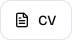
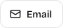
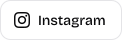
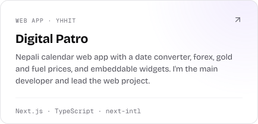
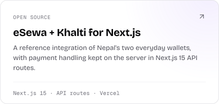
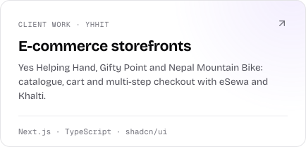
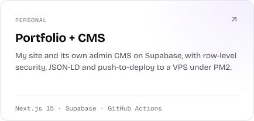

<a href="https://www.amritsapkota0.com.np">
  <picture>
    <source media="(prefers-color-scheme: dark)" srcset="assets/hero-dark.svg">
    <source media="(prefers-color-scheme: light)" srcset="assets/hero-light.svg">
    
  </picture>
</a>

  <a href="https://www.amritsapkota0.com.np"><picture><source media="(prefers-color-scheme: dark)" srcset="assets/btn-portfolio-dark.svg"><source media="(prefers-color-scheme: light)" srcset="assets/btn-portfolio-light.svg"></picture></a>
  <a href="https://www.amritsapkota0.com.np/amrit-sapkota-frontend-developer-cv.pdf"><picture><source media="(prefers-color-scheme: dark)" srcset="assets/btn-cv-dark.svg"><source media="(prefers-color-scheme: light)" srcset="assets/btn-cv-light.svg"></picture></a>
  <a href="mailto:amritsapkota010@gmail.com"><picture><source media="(prefers-color-scheme: dark)" srcset="assets/btn-email-dark.svg"><source media="(prefers-color-scheme: light)" srcset="assets/btn-email-light.svg"></picture></a>
  <a href="https://www.linkedin.com/in/amrit-sapkota-a315b0184/"><picture><source media="(prefers-color-scheme: dark)" srcset="assets/btn-linkedin-dark.svg"><source media="(prefers-color-scheme: light)" srcset="assets/btn-linkedin-light.svg"></picture></a>
  <a href="https://www.instagram.com/_amritsapkota/"><picture><source media="(prefers-color-scheme: dark)" srcset="assets/btn-instagram-dark.svg"><source media="(prefers-color-scheme: light)" srcset="assets/btn-instagram-light.svg"></picture></a>

<picture>
  <source media="(prefers-color-scheme: dark)" srcset="assets/contributions-dark.svg">
  <source media="(prefers-color-scheme: light)" srcset="assets/contributions-light.svg">
  
</picture>

## Selected work

  <a href="https://digitalpatroapp.com"><picture><source media="(prefers-color-scheme: dark)" srcset="assets/work-digital-patro-dark.svg"><source media="(prefers-color-scheme: light)" srcset="assets/work-digital-patro-light.svg"></picture></a>
  <a href="https://github.com/amrit-sapkota/eSewa-and-khalti-nextjs-integration"><picture><source media="(prefers-color-scheme: dark)" srcset="assets/work-esewa-khalti-dark.svg"><source media="(prefers-color-scheme: light)" srcset="assets/work-esewa-khalti-light.svg"></picture></a>

  <a href="https://www.amritsapkota0.com.np/#professional-projects"><picture><source media="(prefers-color-scheme: dark)" srcset="assets/work-storefronts-dark.svg"><source media="(prefers-color-scheme: light)" srcset="assets/work-storefronts-light.svg"></picture></a>
  <a href="https://www.amritsapkota0.com.np"><picture><source media="(prefers-color-scheme: dark)" srcset="assets/work-portfolio-dark.svg"><source media="(prefers-color-scheme: light)" srcset="assets/work-portfolio-light.svg"></picture></a>

## Stack

<picture>
  <source media="(prefers-color-scheme: dark)" srcset="assets/stack-dark.svg">
  <source media="(prefers-color-scheme: light)" srcset="assets/stack-light.svg">
  
</picture>

Open to frontend roles and freelance work · Pokhara, Nepal (UTC+5:45)

